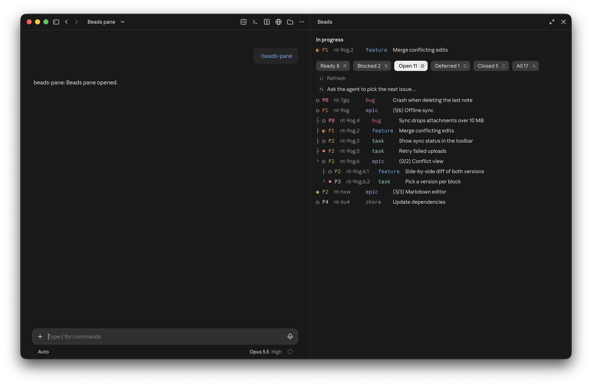
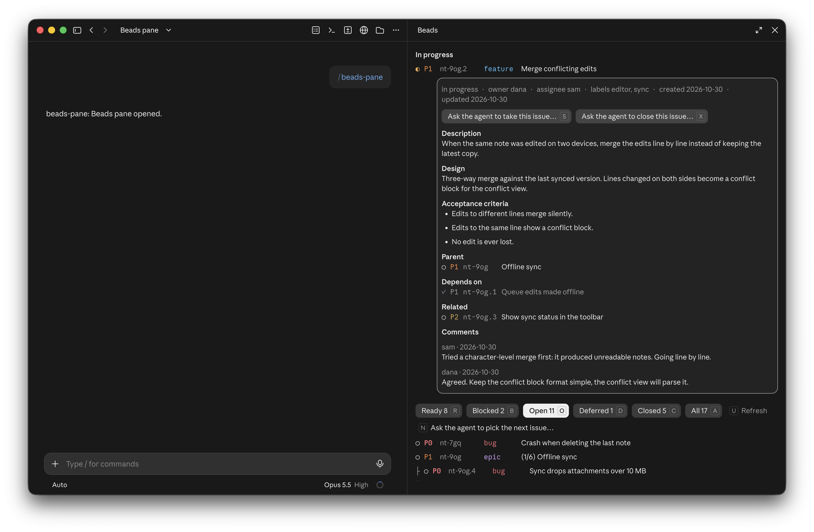

# beads-pane

[](https://code.claude.com/docs/en/plugins/mods/overview)
[](https://github.com/malyinik/beads-pane/releases)
[](https://github.com/malyinik/beads-pane/actions/workflows/check.yml)
[](LICENSE)

A Claude Code plugin that shows [beads](https://github.com/steveyegge/beads) (`bd`) issues in a side pane next to the chat.

The main target is the Claude Code desktop app (`desktop` surface).
The terminal (`terminal` surface) runs the same code.





## Features

- The issues of the session's beads database, in a side pane opened by `/beads-pane`.
- Filters: ready, blocked, open, deferred, closed and all.
- The issues in progress, always in view.
- Epics with their issues and progress.
- An issue's card: its texts, linked issues and comments.
- Buttons that ask the agent to pick the next issue, take one or close one. The pane itself never changes an issue.
- Updates as the agent works with bd.

## Requirements

| What        | Version                                                      |
| ----------- | ------------------------------------------------------------ |
| Claude Code | a build with plugin hooks modules, developed against 2.1.312 |
| `bd`        | 1.2 or later, on `PATH`                                      |

The pane reads the beads database of the session's working directory.

## Install

At the prompt of a Claude Code session, in the terminal or the desktop app:

```
/plugin install beads-pane --marketplace malyinik/beads-pane
```

From a shell:

```bash
claude plugin install beads-pane --marketplace malyinik/beads-pane
```

## Usage

| Command       | What it does         |
| ------------- | -------------------- |
| `/beads-pane` | Opens the beads pane |

## Development

Load the plugin from a working copy for one session:

```bash
claude --plugin-dir ~/beads-pane
```

An interactive session reloads the hooks module when its files change.
The desktop app reads the same folder from `CLAUDE_CODE_PLUGIN_DIRS` in the `env` block of `~/.claude/settings.json`.

Check the manifest and the hooks module:

```bash
claude plugin validate ~/beads-pane
```

Run the tests in `tests/`:

```bash
claude plugin test ~/beads-pane
```

GitHub Actions runs `claude plugin validate` and `claude plugin test` on every push and pull request to `develop` and `main`.

Type-check, once the plugin has loaded and Claude Code has written its types to `.claude-plugin/types/`:

```bash
npx -p typescript tsc -p ~/beads-pane
```

## License

[MIT](LICENSE)
